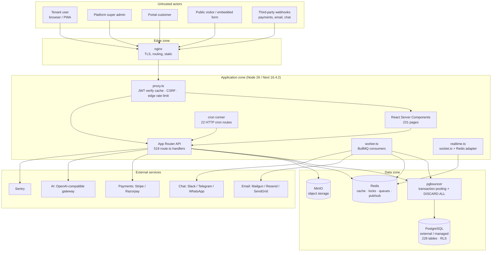
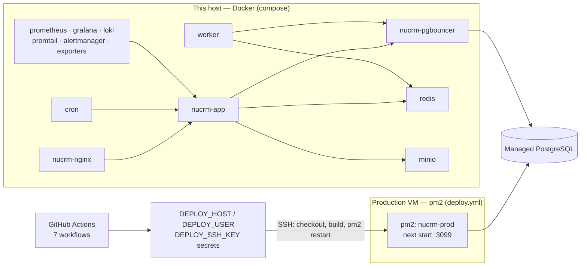
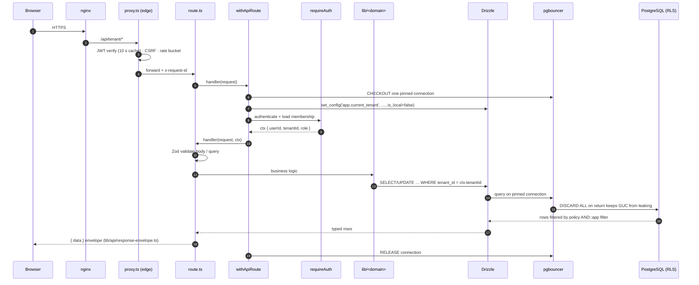
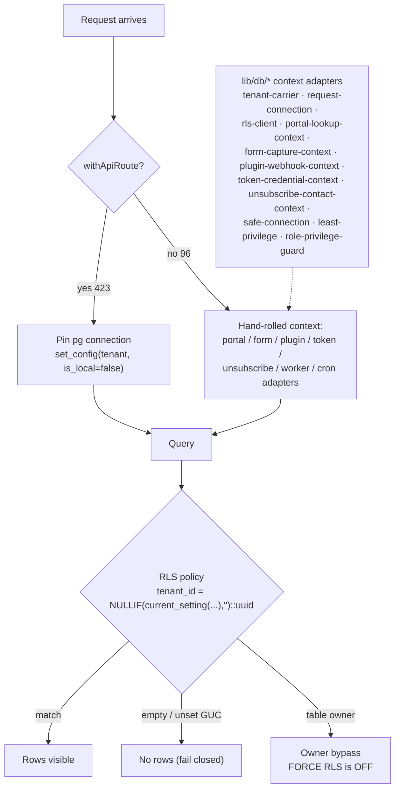
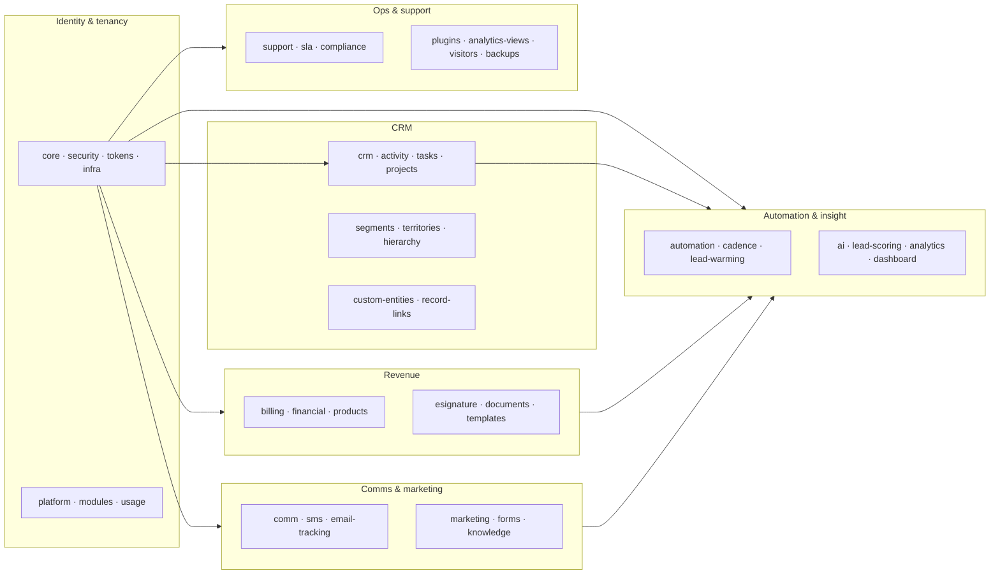
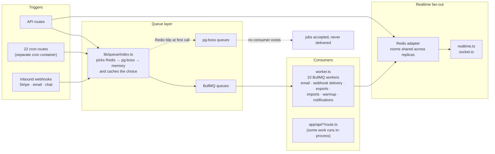
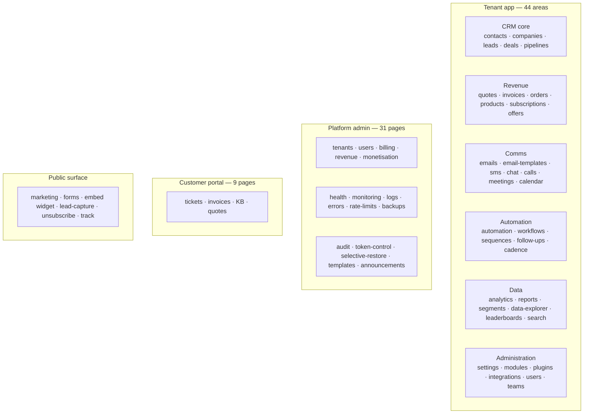
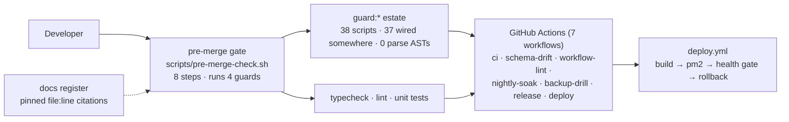

# NuCRM — System Architecture Map

> **What this is.** A layered, visual map of the running system, drawn from the
> code and deploy assets as of 2026-10-31. Every number here was counted from
> the repo, not copied from prose docs. Where the prose docs disagree with the
> code, that disagreement is recorded in [§10 Drift ledger](#10-drift-ledger).
>
> **How to view.** GitHub renders the Mermaid blocks below natively. For a
> standalone, zoomable viewer open
> [`system-map.html`](./system-map.html) in a browser (Mermaid is MIT-licensed,
> loaded from CDN; no build step). To export images, `npx @mermaid-js/mermaid-cli`
> on any block, or paste a block into <https://mermaid.live>.

---

## 1. L0 — System context and trust boundaries

**Trust boundaries to keep in mind**

| Boundary | Control today | Residual risk |
| --- | --- | --- |
| Internet → nginx | TLS, HSTS, nginx rate limits | Edge limiter is per-isolate (ADR-0003-edge) |
| nginx → app | network, `TRUST_PROXY` boot check | Proxy JWT cache lets a revoked token pass for ≤10 s |
| app → Postgres | app-level `tenant_id` filter **plus** RLS | RLS is a backstop, not the primary control (ADR-0002) |
| app → third parties | `safeFetch` SSRF guard, HMAC webhook checks | Per-integration; see §7 |

---

## 2. L1 — Runtime topology and deploy variants

**Compose variants that exist (six):** `docker-compose.yml`, `.scale.yml`,
`.slim.yml`, `.secrets.yml`, `deploy/docker-compose.production.yml`,
`deploy/docker-compose.preprod.yml`. Services in the production variant:
`nginx, certbot, app, worker, cron, redis, minio, minio-init, pgbouncer,
alertmanager, prometheus, grafana, loki, promtail, node-exporter,
redis-exporter, postgres-exporter`. **There is no `postgres` service** —
Postgres is external (ADR-0005 managed PostgreSQL), reached through pgbouncer.

> **Design note.** Six compose files with overlapping service definitions is a
> drift surface: a fix applied to one variant silently misses the others. The
> `guard:running-config` script exists precisely because of this.

**The two environments do not connect to the database the same way:**

| Environment | `DATABASE_URL` target | `PGBOUNCER_ENABLED` | pgbouncer `POOL_MODE` | GUC reset on release |
| --- | --- | --- | --- | --- |
| Base `docker-compose.yml` | `localhost:5432` (direct) | commented out | `transaction` (service unused) | app does it (`!pgBouncer`) |
| `.env.example` | `host:5432` (direct) | **`true`** | n/a | **skipped** — template bug |
| `deploy/docker-compose.preprod.yml` | `pgbouncer:6432` | `true` | **`session`** | pgbouncer `DISCARD ALL` |
| `deploy/docker-compose.production.yml` + `.env.production` | `postgres:5432` (direct) | `false` | `transaction` (service unused) | app does it |
| `deploy/pgbouncer/pgbouncer.ini` | — | — | **`transaction`** | **inert** (pgbouncer ignores reset in tx mode) |

> **Security-relevant contradiction.** ADR-0003 calls `server_reset_query =
> DISCARD ALL` "load-bearing", but the preprod overlay states — correctly — that
> pgbouncer does **not** run `server_reset_query` in transaction mode. The
> shipped `.ini` and the production compose both say `transaction`. And
> `.env.example` enables the pgbouncer code path while pointing at a direct
> `:5432` URL, which turns off the app's own release-reset. See
> [DESIGN-ISSUES-2026-10-31.md](../reports/DESIGN-ISSUES-2026-10-31.md#h1).

---

## 3. L2 — Request lifecycle (tenant data path)

**Two isolation layers, by design (ADR-0002 + ADR-0003):**
application-level `tenant_id` filters are primary; RLS is the database backstop.
`withApiRoute` is the canonical path: **423 of 519** route handlers use it.

**The 96 handlers that do not** are mostly legitimately outside a tenant context
(auth flows, cron, webhooks, public/embed, dev tooling) — but each one is a
hand-built context path. See [§9 Hotspots](#9-hotspots--where-the-issues-concentrate).

> **Authorization is voluntary on this path (H9).** After `requireAuth`, a route
> may call `can(ctx, …)` / `requirePerm`, check `ctx.isAdmin`, run
> `enforceFieldRead/Write`, or nothing at all — **66 of 248** mutating tenant
> routes do the last. Identity is a choke point (`requireAuth`); authority is
> four parallel mechanisms with no rule saying which handler owes which.

---

## 4. L3 — Multi-tenancy and RLS state model

**The load-bearing invariants (from ADR-0003):**

1. `set_config(..., is_local=false)` when there is no transaction — so the GUC
   survives for the connection checkout.
2. pgbouncer `server_reset_query = DISCARD ALL` — otherwise the GUC leaks to the
   next request on the same server connection.
3. Policies fail **closed** (empty GUC → `NULL` → no rows), not with an error.
4. `FORCE ROW LEVEL SECURITY` is **off** because the app connects as the table
   owner and 28 superadmin/cron routes legitimately read across tenants.

> **Consequence.** A propagation regression shows up as *silence* ("no data"),
> not a crash. That is why `npm run db:verify-isolation` exists.

---

## 5. L4 — Data layer map (46 schema modules · 226 tables · 146 migrations)

Schema lives in `drizzle/schema/*.ts` (one file per domain, re-exported by
`index.ts`). Migrations are numbered SQL under `drizzle/migrations/` — **146** journal
entries, each with a `.down.sql`, so 292 files. Count them from
`drizzle/migrations/meta/_journal.json`, not with a file glob.
Drizzle is chosen over Prisma (ADR-0001) and there is **no** `prisma/` client.

---

## 6. L5 — Async work and realtime

**Job inventory (from `worker.ts` / `lib/queue`):** scheduled jobs, email
sending, notification writing, webhook delivery, exports, imports, lead-warming,
at-risk processing, and retention. The 22 cron routes are the HTTP-triggered
scheduler surface:

`ai-auto-followup, auto-backup, backup, backup-health, backup-verify, cleanup,
contract-renewal-check, detect-missed-followups, lead-warming, process-at-risk,
process-lead-scoring, process-sequences, recurring-invoice-generator,
retry-webhooks, scheduled-report-delivery, sla-check, subscription-check,
subscription-renewal-check, task-reminders, trial-check, usage-snapshot,
warmup-emails`.

**Schedule matrix (measured, not copied from a comment):**

| Scheduler | Jobs | Missing routes |
| --- | --- | --- |
| `deploy/cron/crontab` (**production Docker / pm2 VM**) | 17 | `backup`, `lead-warming`, `process-lead-scoring`, `recurring-invoice-generator`, `sla-check` |
| `vercel.json` | 18 | `backup`, `lead-warming`, `process-lead-scoring`, `sla-check` |
| `scripts/cron-scheduler.ts` (in-process) | 18 | `process-lead-scoring`, `sla-check`, `scheduled-report-delivery`, `subscription-renewal-check` |

`process-lead-scoring` and `sla-check` are scheduled by **no** source.
`check-cron-lock.mjs` keeps the crontab gaps in a tracked-debt set, so it stays
green; `/api/system/cron-health` reads an in-memory registry that **0 of 22**
routes write, so it always reports `healthy` with `totalJobs: 0`.

> **Design notes.**
> 1. `lib/queue/index.ts` can select **pg-boss**, but the only consumer in the
>    repo is `worker.ts` (BullMQ). A Redis failure at the first `getQueueAdapter()`
>    call is cached for the process lifetime and routes later jobs into a queue
>    nothing reads (#401, design report H8).
> 2. Scheduling is written three times in three dialects. Divergence is a guard
>    *note*, not a failure (design report H7).

---

## 7. L6 — Domain / feature surface

**API namespaces (route handlers):** `tenant` 326, `superadmin` 55, `cron` 22,
`auth` 21, `super-admin` 16, `public` 14, `v1` 11, `user` 7, `webhooks` 7,
`system` 7, `dev` 4, `admin` 3, `track` 3, `health` 3, `setup` 3, `scim` 2,
`v2` 2, and one each for `openapi`, `metrics`, `embed`, `forms`, `unsubscribe`,
`logs`, `bug-report`, `emergency`, `flags`, `keepalive`, `test`, `test-email`.

> **Design note.** Three admin namespaces coexist: `superadmin` (55),
> `super-admin` (16), `admin` (3). Two public API generations coexist: `v1` and
> `v2`. Both are long-lived aliasing surfaces — see §9.

---

## 8. L7 — Control plane: how the architecture is enforced

**Guard families (38 scripts)** fall into five groups:

| Family | Examples | Detection style |
| --- | --- | --- |
| Tenant/RLS | `guard:rls`, `guard:portal-rls-context`, `guard:app-role-counts` | route coverage + live DB |
| Data safety | `guard:chain`, `guard:migration-rls`, `guard:rollback-coverage`, `guard:counters` | migration parsing + live DB |
| Surface safety | `guard:csrf`, `guard:public-ratelimit`, `guard:public-projection`, `guard:raw-sql`, `guard:semgrep` | grep / semgrep |
| Deploy-config truth | `guard:pool-mode`, `guard:pool-tls`, `guard:running-config`, `guard:pm-log-paths` | parse compose/ini + live container |
| Hygiene | `guard:filesize`, `guard:any-suppressions`, `guard:vocab`, `guard:register-drift`, `guard:coords` | regex + writable baselines |

> **Design note.** Most invariants are enforced by bespoke scripts rather than by
> types, DB constraints, or a single choke-point API. A guard that greps for a
> pattern catches only the spelling it was told about — **none of the 38 parses a
> TypeScript AST**. `guard:pool-mode` (#3404) is at least the first to parse its inputs
> structurally at all — compose YAML, not a line pattern — which is the shape the rest
> of this list needs. Wiring is not the gap either: `ci.yml` covers 34 of the 38 (31 by
> alias, 3 more invoked as bare `node scripts/…`), `nightly-soak.yml` adds 3, so
> **37 run in some workflow** and only `guard:migration-redecl` runs nowhere; the
> local `pre-merge-check.sh` an agent is told to run invokes 4 while no workflow calls
> it. So the estate is not under-run — it is under-seeing, and its own census is
> ungrepable: grepping `npm run guard:[a-z-]+` cannot see a bare invocation, which is
> how this paragraph read "30 wired, 4 unwired" for a day. (The count itself is
> evidence too: 35 on 2026-10-31, 37 on 2026-11-01. Quote the command, not the
> number — and make the command resolve aliases to files.)
>
> Authorization is the clearest case: the guard estate covers CSRF, raw SQL,
> public rate limits and RLS context, but **no** guard asks whether a
> `POST`/`PATCH`/`DELETE` handler under `app/api/tenant` checked a permission.
> A new ungated mutating route passes CI.

---

## 9. Hotspots — where the issues concentrate

This overlay maps the nine recurring fix families onto the layers
above. It is the visual companion to
[`../reports/DESIGN-ISSUES-2026-10-31.md`](../reports/DESIGN-ISSUES-2026-10-31.md).

```mermaid
flowchart TB
  subgraph H1["H1 · Tenant context (RLS)"]
    A1["Every new entry point must remember<br/>to open a context. 96 routes +<br/>worker/cron/webhook/portal adapters."]
  end
  subgraph H2["H2 · Soft-delete (tombstone)"]
    A2["deletedAt filtered per query,<br/>not by view or policy."]
  end
  subgraph H3["H3 · Lifecycle state"]
    A3["Status transitions written ad hoc;<br/>CAS from-state re-added per route."]
  end
  subgraph H4["H4 · Result contracts"]
    A4["{success:false} helpers ignored;<br/>frontend conflates failed / stale / empty."]
  end
  subgraph H5["H5 · Counters & quotas"]
    A5["Denormalised counters mutated by<br/>many call sites; check outside tx."]
  end
  subgraph H6["H6 · Enforcement drift"]
    A6["Guards + doc register pinned to line<br/>numbers; re-pin churn every merge."]
  end
  subgraph H7["H7 · Scheduled work"]
    A7["Three schedule files; two routes in none;<br/>health registry has no writer."]
  end
  subgraph H8["H8 · Background delivery"]
    A8["Producer can pick pg-boss;<br/>only BullMQ has a consumer."]
  end
  subgraph H9["H9 · Authorization"]
    A9["66/248 mutating routes gate on nothing;<br/>catalog ≠ checks; record_permissions unread."]
  end
  A1 --> L2["L2 request path"]
  A2 --> L4["L4 data layer"]
  A3 --> L4
  A4 --> L2
  A5 --> L4
  A6 --> L7["L7 control plane"]
  A7 --> L5["L5 async + realtime"]
  A8 --> L5
  A9 --> L2
  A9 --> L7
```

---

## 10. Drift ledger

Measured against the code on 2026-10-31; prose docs currently disagree.

| Claim | Prose says | Code says | File |
| --- | --- | --- | --- |
| API endpoints | 507 | **519** `route.ts` | `ARCHITECTURE.md` |
| Tables | ~215 / 224 | **226** `pgTable(...)` declarations | `PROJECT_MAP.md`, `ARCHITECTURE.md` |
| Process manager | "pm2 in production" | Docker on **this** host; pm2 only on the production VM | `docs/agent-plans/PROJECT_MAP.md` vs `AGENTS.md` |
| ADR numbering | unique | **collisions**: two each of 0001–0006, and 0011 collides | `docs/adr/` |
| Queue tech | BullMQ | BullMQ **and** pg-boss; only BullMQ is consumed | `lib/queue/index.ts`, `worker.ts` |
| Cron schedules | one source of truth | three files (17 / 18 / 18 jobs); two routes in none | `deploy/cron/crontab`, `vercel.json`, `scripts/cron-scheduler.ts` |
| Cron health | dead-man switch | registry has **no writer** in any route | `lib/cron/health.ts` |
| Role permissions | one catalog of 66 ids drives the Roles UI | routes check **74** strings; **21** are un-grantable, **16** are never checked | `lib/permissions/definitions.ts` vs `app/api` |
| Record permissions | per-record grants with expiry | **0** production importers of `lib/rbac/record-permissions` — rows change nothing | `app/api/tenant/rbac/record-permissions/route.ts` |
| Field permissions | hide/show fields per role | enforced in **30 of 326** tenant routes; 98 call sites | `lib/rbac/enforce.ts` |
| Pages | 150 tenant / 31 superadmin / 19 marketing / 9 portal | `find app -name page.tsx` → 231 total | `ARCHITECTURE.md` |
| RLS reach | "FORCE RLS is off" | FORCE is **on** for 13 tables (`tenants`, `users`, revenue line items, …) | `docs/adr/0003` vs `drizzle/migrations/0068,0107,0141` |
| Pool mode | "transaction + DISCARD ALL is load-bearing" | preprod proves that pairing is inert; `.ini` and prod compose still say `transaction` | `docs/adr/0003` vs `deploy/docker-compose.preprod.yml:47` |
| pgbouncer template | pooler enabled | `.env.example` sets `PGBOUNCER_ENABLED=true` with a direct `:5432` URL | `.env.example` |
| TLS verification | "verify in production" | pm2 sets `DATABASE_SSL_REJECT_UNAUTHORIZED=false` for web/worker/cron | `ecosystem.config.cjs:108,150,185` |

---

## 11. Measured inventory

| Thing | Count | How measured |
| --- | --- | --- |
| `app/**/route.ts` | 519 | `find app -name route.ts` |
| `app/**/page.tsx` | 231 | `find app -name page.tsx` — a `grep 'page.tsx$'` over paths answers **232**, because `client-page.tsx` is not a page |
| Routes using `withApiRoute` | 423 | `grep -rl withApiRoute app` |
| Files importing a DB client | 140 | `grep -rlE "from '@/lib/db\|from '../lib/db'\|drizzle-orm/node-postgres" app lib components` |
| Schema files | 46 direct + 17 under `registry/` = 63 | `ls drizzle/schema/*.ts`; the `registry/` half is easy to miss |
| `pgTable` declarations | 226 | grep in `drizzle/schema` |
| Migrations | 146 (up) / 146 (`.down.sql`) / 292 `.sql` total | `node -pe "require('./drizzle/migrations/meta/_journal.json').entries.length"` — the journal, not a file glob, is the number |
| `lib/**/*.ts` | 442 | `find lib -name '*.ts'` |
| Guard scripts | 38 aliases over 38 distinct files, 11,624 lines; 37 wired somewhere | `node scripts/guard-census.mjs` once PR-7D ships it; until then see §8's design note — re-run it, it moves weekly (37→38 the day #3404 landed) |

> **Every number in this table was re-measured against `origin/main` on 2026-11-03.**
> Four had moved since the 2026-11-01 audit (tenant pages 149→150, migrations
> 142→146 pairs, `lib/**/*.ts` 430→442, guards 35→37→38) and not one of those moves was
> a regression — it is what a living tree does to a document that quotes numbers. Two
> numbers were also **wrong in this author's own draft**, both from bad commands rather
> than bad luck: `grep 'page.tsx$'` over paths answered 232 because a component called
> `client-page.tsx` is not a page, and grepping workflows for `npm run guard:` answered
> "30 wired" because three guards are invoked as bare `node scripts/…`. So: **cite the
> command, and only trust a census command that can see the whole spelling space.**
| CI workflows | 7 | `.github/workflows/` |
| Cron routes | 22 | `app/api/cron/*/route.ts` |
| Cron routes scheduled by ≥1 source | 20 | union of the three schedule files |
| Cron routes writing a health record | 0 | `grep registerCronRun app` |
| Declared queue job types | 10 | `JobType` in `lib/queue/index.ts` |
| Queue types with a producer / consumer | 7 / 10 | `addJob` call sites / `new Worker` |
| Mutating tenant routes | 248 | `grep -rlE "export const (POST\|PATCH\|PUT\|DELETE)" app/api/tenant` |
| …with no permission check | 66 | `comm -23` of the above vs `can(`/`requirePerm(`/`ctx.isAdmin` |
| Permission ids in the UI catalog | 66 | `grep -o "id: '…'" lib/permissions/definitions.ts` |
| Permission strings routes check | 74 | `can`/`requirePerm`/`ownerScope` literals |
| …not in the catalog (un-grantable) | 21 | `comm -23` |
| …never checked anywhere | 16 | `comm -13` |
| Compose variants | 6 | repo root + `deploy/` |

---

## 12. How to regenerate / extend

- Counts: the commands in §11 are reproducible as-is.
- Diagrams: Mermaid 11 (MIT). `npx @mermaid-js/mermaid-cli -i SYSTEM-MAP.md -o out.svg`
  renders every block; or use <https://mermaid.live>.
- If you add a layer (e.g. a new data store or queue), add a view here **and**
  add the corresponding line to §10 if any prose doc now disagrees.
