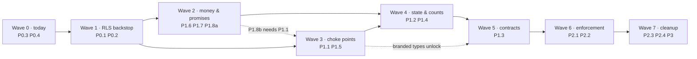

# NuCRM — Remediation Plan

**Date:** 2026-11-01 · **Source:** [`DESIGN-ISSUES-2026-10-31.md`](./DESIGN-ISSUES-2026-10-31.md)
(families **H1–H9**) · **Map:** [`../architecture/SYSTEM-MAP.md`](../architecture/SYSTEM-MAP.md)

This turns the audit's roadmap (§7) into **22 reviewable PRs**, ordered so that each
one lands on its own, proves itself, and can be reverted alone. It obeys
`AGENTS.md`: one issue per PR, `fix/<short-description>` branches, PR base `main`,
never push to `main`.

---

## 0. The gate every PR must pass

Nothing in this plan is "done" until the following is green on the branch. Copy the
block into the PR description.

```bash
# 1. never work on main; never share .next with another build
git checkout main && git pull && git checkout -b fix/<short-description>
rm -rf .next

# 2. the two things that actually catch regressions here
npm run lint
npm run typecheck        # tsc + scripts/check-scripts-typecheck.mjs (#3413 landed;
                         # `scripts/**` is no longer outside the gate)

# 3. the invariant guards relevant to the family you are fixing
npm run guard:rls guard:portal-softdelete guard:counters \
      guard:field-permissions guard:cron-lock guard:pool-tls \
      guard:running-config guard:vocab guard:chain 2>&1 | tail -40

# 4. full suite — must be 100% before push
bash postman/full-test-suite.sh

# 5. build (≈5 min; never run two at once)
npm run build
```

Conventions this repo already uses, and the plan keeps:

- **Test naming:** `tests/unit/<topic>-<issue-number>.test.ts`
  (e.g. `forgot-password-tombstone-3401.test.ts`).
- **Migration naming:** next free number under `drizzle/migrations/`, always with a
  down-migration, applied with `npm run db:migrate` — never `drizzle-kit push`.
- **Destructive DB work:** `npm run db:state` first; `db:drop`/`db:reset` only with
  `--yes` and never against a `POPULATED` target.
- **A missing context must become a type error or a red build**, never a log line.
  That is the entire point of this plan; every PR below is judged by whether it
  moves one invariant into a choke point.

---

## 1. Wave map and dependencies



Read down the waves, not across: **Wave 0 and 1 change no behaviour a customer can
see**, and they are what makes every later wave safe to ship.

| Wave | PRs | Calendar | What it buys |
| --- | --- | --- | --- |
| 0 | 2 | this week | A closed security path + a `tsc` error that CI cannot see |
| 1 | 3 | this week | RLS becomes a real backstop instead of an environment lottery |
| 2 | 4 | next 2 weeks | Invoices recur, SLAs fire, jobs stop vanishing, members stop sending invoices |
| 3 | 4 | weeks 3–5 | Tenant context and liveness become structural, not conventional |
| 4 | 3 | weeks 5–7 | Status transitions and counters get a single owner |
| 5 | 3 | weeks 7–9 | Failure becomes impossible to ignore at every boundary |
| 6 | 2 | weeks 9–10 | Guards enforce instead of theatre; the 25% citation churn stops |
| 7 | 4 | week 11 | Naming, factories, docs |

---

## 2. Wave 0 — land today (XS, no behaviour risk)

Every finding in this plan that had no existing issue was filed on 2026-11-01; the
five that were already tracked got a cross-link comment instead of a duplicate.

| Plan PR | Issue | Tracked elsewhere | Status on `main` |
| --- | --- | --- | --- |
| PR-0A | **#3413** | — | ✅ merged (#3430) |
| PR-0B | **#3401** | — | ✅ merged (#3417) |
| PR-1A | **#3404** | #674 (epic), prior instances #642 #1615 #2574 | 🚧 in review (**#3445**) — declared-mode half; the `SHOW pool_mode` boot assertion and the `guard:running-config` declared-vs-live diff are recorded there as the residual |
| PR-1B | **#3403** | #3303 (closed, fixed via #3431), #3312 (open) | ✅ **code** merged (#3246 whatsapp/payu/resend + #3436 billing pair) — the "leftover" this row carried was a bad grep, see §3; integration proof still missing for `payu` and `whatsapp` |
| PR-1C | **#3403** / **#3412** | #3312 | open |
| PR-2A/2C | **#3410** | — | open |
| PR-2B | **#3410** | **#2539** (closed 2026-11-03, verified on `main`: a refused cron lock now answers `423 {ok:false}` — only the orphan half is left, and #3410 owns it) | open (orphans only) |
| PR-2D | **#3411** | prior #1355 #1470, epic-backlog #401 | open |
| PR-2E / PR-3D | **#3402** | **#2597** (open — owns field/record enforcement) | open |
| PR-3A | **#3405** | — | open |
| PR-3B / PR-3C | **#3406** | — | open |
| PR-4A | **#3407** | — | open |
| PR-4B / PR-4C | **#3409** | — | open |
| PR-5A/5B/5C | **#3408** | — | partial (#3423: one guard test landed) |
| PR-6A / PR-6B | **#3412** | **#3399** (closed 2026-11-03 — the README arithmetic it owned is now correct; the census *command* is still this plan's work) | open |
| PR-7A–7D | not filed (cleanup) | #3399 for the census half of 7D | open |

Three of the twenty-two are already done by other agents, so **do not re-prescribe
them** — each PR section below carries its own `Landed` row, and what is still open.

### PR-0A — `fix/restore-db-duplicate-import` · **P0.3** · ✅ LANDED (#3430)

`scripts/**` was excluded from `tsconfig`, so a TS2300 that CI never sees was sitting
in the tree.

| | |
| --- | --- |
| **Files** | `scripts/restore-db.ts` (now a single `pgSslConfig` import), `tsconfig.scripts.json` (new), `scripts/check-scripts-typecheck.mjs` (new), 21 further script errors |
| **Change landed** | The duplicate imports are gone **and** the structural half shipped: `scripts/**` now has its own project (`tsconfig.scripts.json`) wired into `npm run typecheck` via `scripts/check-scripts-typecheck.mjs`, so a script type error is a red `npm run check` instead of an invisible file. |
| **Prove** | Reproduced and closed on the branch; `npm run typecheck` is the standing proof now. |
| **Still open** | The `fix/pool-tls-default` follow-up (B2) below was *not* part of #3430. |

> Do **B2** (TLS default) as its own PR — `fix/pool-tls-default` — touching
> `lib/db/ssl-config.ts` + `scripts/check-pool-tls-policy.mts`, because it changes
> connection behaviour and this one had to stay a no-op.

### PR-0B — `fix/password-reset-tombstone` · **P0.4** · ✅ LANDED (#3417)

A soft-deleted user could reset their password and mint a session — the smallest real
security hole in the audit.

| | |
| --- | --- |
| **Files** | `app/api/auth/forgot-password/route.ts:80`, `lib/auth/password-reset.ts:90` |
| **Change landed** | Both email lookups now carry `isNull(users.deletedAt)` inside the existing `withAuthLookupContext(...)` select, and the branch went further than the plan asked (`3813766db` — *"a soft delete ends the credential path, not just the org chart"*), covering the login/sign-in path too rather than only the reset request. Response envelope unchanged, so no enumeration oracle. |
| **Prove** | `tests/unit/forgot-password-tombstone-3401.test.ts` + companions, pinned in CI. |
| **Risk** | Realised as predicted: the only behaviour change is that a deleted account stops receiving reset mail. |

Note for context: `reset-password` already filters correctly
(`app/api/auth/reset-password/route.ts:57-64` uses `isNull(passwordResets.deletedAt)`
+ `gt(expiresAt, new Date())`), so the fix belongs at the *lookup*, exactly where
`forgot-password` and `requestPasswordReset` resolve the user.

---

## 3. Wave 1 — make RLS a backstop (H1) · **P0.1 + P0.2**

Today whether RLS is enforced depends on which compose file built the box.
`deploy/pgbouncer/pgbouncer.ini:10` still says `pool_mode = transaction` while
preprod runs `session` (`PGBOUNCER_ENABLED=true` at lines 148/244/366 of
`deploy/docker-compose.preprod.yml`), and `server_reset_query = DISCARD ALL`
(`.ini:18`) is inert in transaction mode. Migration `0100` already recorded the
consequence: *"UPDATE … rowCount = 0 (silent) … every job logged success while
changing nothing."*

### PR-1A — `fix/pool-mode-session-invariant` · **P0.1**

| | |
| --- | --- |
| **Files** | `deploy/pgbouncer/pgbouncer.ini`, `deploy/docker-compose.preprod.yml`, `deploy/docker-compose.production.yml`, `docs/adr/0003-rls-session-scoped-guc-with-pgbouncer.md`, `lib/db/rls.ts` (boot assertion), `scripts/check-running-config-drift.mjs` |
| **Change** | ① `pool_mode = session` everywhere, and delete the prod path that bypasses the pooler (`PGBOUNCER_ENABLED=false` + direct `postgres:5432`) or document it as unsupported. ② Amend ADR-0003 so it describes what ships (session mode; `DISCARD ALL` runs per release) and stop citing transaction pooling as the design. ③ Boot assertion: on startup `SELECT @@version`-adjacent check `SHOW pool_mode` via the pgbouncer admin database and `SELECT current_setting('is_superuser')`, and **refuse to serve** if the mode is not `session`. ④ Extend `guard:running-config` to diff declared vs running pool mode so a drift is a red build, not a comment. |
| **Prove** | Integration test asserting the boot assertion fires when `pool_mode != session`; manual: `psql -p 6432 -c 'SHOW pool_mode'` → `session`; `npm run guard:running-config` green. |
| **Rollback** | Revert the compose/`.ini` diff and redeploy. It is config-only; keep the boot assertion in a follow-up if the mode change must be staged. |
| **Risk** | **Medium — capacity.** Session mode holds one backend per client, so pgbouncer's `max_client_conn`/`default_pool_size` in `.ini` must be sized against the app's pool max (`lib/db/*`) or the box will refuse connections under load. Do this on the preprod box first, watch `nucrm-pgbouncer` logs and `/api/health` for a day. Coordinate with the deploy owner before touching production. |

### PR-1B — `fix/webhook-system-context` · **P0.2** · ✅ CODE LANDED (#3246 + #3436) · 🟡 the proof half is still open

Provider webhooks are anonymous and write FORCE-RLS tables. **The "leftover" this row
carried since #3436 merged was an artifact of the command below, not a defect in the
tree.** Do not "fix" these three routes; they are already closed. Re-measured on
`origin/main` at `84ae3767`, and the two things the original command got wrong are the
finding:

```bash
for r in razorpay stripe whatsapp payu inbound resend telegram/bot; do
  f=app/api/webhooks/$r/route.ts
  [ -e "$f" ] && printf "%-11s ctx=%s writes=%s\n" "$r" \
    "$(grep -cE 'withApiRoute|withSystemContext|withBillingWebhookContext|set_config|app\.current' "$f")" \
    "$(grep -cE '\.insert\(|\.update\(|\.delete\(|\.execute\(' "$f")"
done
```

**(1) The `ctx` pattern never listed the helper those routes actually call.**
`withTenantScope` and `withTenantContext` — the two names in `lib/api/with-api-route.ts`
and `lib/db/rls.ts` that every one of the three uses — are absent from the alternation,
so a route fully wrapped in them answers `ctx=0`. **(2) The `writes` pattern counts
crypto.** `createHmac('sha256', secret).update(rawBody)` matches `\.update\(`, which is
where `whatsapp (1 write)` came from: that route contains **no** database statement at
all. It hands the payload to `addJob('whatsapp-webhook', …)` or, if the queue is down,
to `processWhatsAppPayload(body)` — one file away, which is exactly the delegation the
grep-per-file method cannot see, and the reason the surviving rule has to be a graph
walk (PR-1C) rather than a loop over route files.

What is on `main`, per provider, with the suite that pins it:

| Route | Context | Verified by |
| --- | --- | --- |
| `razorpay`, `stripe` | `lib/db/billing-webhook-context.ts` — payload→tenant derivation, `NO_USER_SENTINEL`, `rowCount` split into `applied`/`unknown_tenant`/throw (#3436) | `webhook-billing-tenant-context-3403.test.ts`, `rls-guard-webhook-billing-writes-3403.test.ts`, `tests/integration/webhooks-under-force-rls.test.ts` |
| `payu` | `withTenantScope(() => handlePayu(request))` at `route.ts:64`; the owner lookup runs in `withQuoteWebhookLookupContext` (`lib/db/quote-webhook-context.ts`) at `:135`, and the three writes after it are all `tx` statements inside `withTenantContext(owner.tenantId, NO_USER_SENTINEL, …)` opened at `:156` | `payu-webhook-tenant-context-3246.test.ts` |
| `resend` | `withTenantScope(() => handleResend(req))` at `route.ts:85`; `attributeResendEvent` resolves the workspace *before* any write, and every handler in `lib/email/resend-event-handlers.ts` runs inside `withTenantContext` | `resend-webhook-tenant-adoption-3246.test.ts`, and **`tests/integration/resend-webhook-tenant-scope-2406.test.ts`** — 433 lines that import the real `POST` (`:135`), fire a signed Svix body and read `contacts.doNotContact` back for both workspaces |
| `whatsapp` | `lib/whatsapp/webhook-processor.ts:101` and `:213` — `resolveWhatsAppTenant(receiving_phone_id)` first, then `withTenantContext(tenantId, NO_USER_SENTINEL, …)`; the same function serves both the inline fallback (`route.ts:76`) and the queue worker (`worker.ts:503`) | `whatsapp-webhook-tenant-context-3246.test.ts`, `whatsapp-webhook-processor.test.ts` |
| `inbound` | `withTenantScope(() => handleInbound(request))` at `route.ts:866` — 13 writes, all after it; its own comment records that `withApiRoute` is the authenticated wrapper and cannot cover this anonymous path | `inbound-webhook-auth-lookup-3246.test.ts`, `webhook-inbound-audit.test.ts` |
| `telegram/bot` | writes nothing | — |

Those five suites pass on `84ae3767` — `npx vitest run tests/unit/{payu-webhook-tenant-context-3246,resend-webhook-tenant-adoption-3246,whatsapp-webhook-tenant-context-3246,webhook-billing-tenant-context-3403,rls-guard-webhook-billing-writes-3403}.test.ts` → **97 passed**.

| | |
| --- | --- |
| **Still open** | The *integration* proof this row asked for exists for four of the six writers — the billing pair (`tests/integration/webhooks-under-force-rls.test.ts`, 514 lines) and `resend` (`tests/integration/resend-webhook-tenant-scope-2406.test.ts`) — but **`payu` and `whatsapp` are asserted only by unit suites that mock or stub the transaction**. Nothing on `main` proves a `payu` payment actually lands in a FORCE-RLS `invoice_payments`, or that a WhatsApp message lands in `whatsapp_messages` for the workspace that owns the number; the code asks for the right context and the tests confirm the ask. #3246 fixed the bug; the end-to-end evidence for two of them is the gap. |
| **Change** | Extend `tests/integration/webhooks-under-force-rls.test.ts` with one recorded payload each for `payu` and `whatsapp` and assert the row **exists afterwards** (the failure mode is a silent `rowCount = 0` behind a 200). Keep its `beforeEach` re-asserting `FORCE ROW LEVEL SECURITY` on the target table per case, not once in `beforeAll` — the pattern #3436 shipped at `:327`, and the one `resend`'s own integration file does **not** do, which is worth copying rather than inheriting. |
| **Rollback** | Test-only. Nothing to roll back in the app. |
| **Depends on** | PR-1A — a session-scoped GUC under transaction pooling fails in a way an integration test on a dev box with no pooler will never show. #3436 shipped without it; that is the risk to read into the remaining two, not a reason to leave the routes alone. |
| **Risk** | Low: this is evidence, not behaviour. Expect it to *find* something — a provider whose real write path differs from the unit-mocked one is precisely what the #3246 suite would not have caught. |


### PR-1C — `fix/rls-route-coverage-real-guard` · 🟡 PARTIALLY LANDED (#3436)

`scripts/check-rls-route-coverage.mjs` checks identity tables in a few entry files,
exempted any file that merely *mentions* a helper, and never scanned `app/api` for
business tables. Until it can see the bug, every later fix can regress. #3436 grew it by
~115 lines to understand the billing-webhook rule, so the scope below is now partly
paid — re-read the script on the branch before writing anything.

| | |
| --- | --- |
| **Files** | `scripts/check-rls-route-coverage.mjs` |
| **Change** | Widen scope to `app/api/**/route.ts`, server actions, `lib/**` and `scripts/cron-scheduler.ts` targets; count a file covered only when a context helper **wraps** the call, not when the name appears; add the `app/api/webhooks` rule from PR-1B here rather than a new script — and follow the **import**, because PR-1B's own lesson is that a per-file scan cannot see `app/api/webhooks/whatsapp/route.ts` hand its payload to `lib/whatsapp/webhook-processor.ts:101` where the transaction actually opens, so a rule that reads one file reports a route that writes nothing as if it wrote unguarded. Pin the current count as a floor so it can only decrease. |
| **Prove** | `npm run guard:rls` fails on a deliberately unwrapped `POST` in a scratch file; passes on the tree; the floor number is written into the script. The negative control this row used to name — `app/api/webhooks/resend/route.ts`, `ctx=0 writes=1` — **is gone**: #3246 wrapped it in `withTenantScope`, so it is now an example the guard must accept. A control has to be planted in a scratch tree, which is what the first clause already says, and the guard must also reject the inverse: an unwrapped file that merely *imports* a context helper still counts as uncovered. |
| **Risk** | The first run will report many sites. Land it **with** the floor and an allowlist of the exact files still uncovered, so it is green and can only get greener. |

---

## 4. Wave 2 — work that is silently failing right now · **P1.6, P1.7, P1.8a**

These are the three findings with a live business consequence. They need no schema
work and no new abstractions, so they go before the structural waves.

### PR-2A — `fix/cron-manifest-single-source` · **P1.6 (part 1)**

22 cron routes are scheduled by three owners: `deploy/cron/crontab` (17),
`vercel.json` (18), `scripts/cron-scheduler.ts` (18). `process-lead-scoring` and
`sla-check` appear in **none**; the production crontab omits
`recurring-invoice-generator` and `lead-warming`.

| | |
| --- | --- |
| **Files** | new `lib/cron/jobs.ts`; `deploy/cron/crontab`, `vercel.json`, `scripts/cron-scheduler.ts`; `scripts/check-cron-lock.mjs`; new `scripts/gen-cron-manifest.mjs` |
| **Change** | One manifest of `{ name, path, cron, owner, maxDurationMs, expectedEveryMs }`. Generate the three schedules from it (a `prebuild` step + `guard:cron-manifest` asserting the checked-in files equal the generated output). Divergence becomes a red build instead of a comment in `check-cron-lock.mjs`'s tracked-debt list. |
| **Prove** | `npm run guard:cron-manifest`; a test deleting any entry from `crontab` fails; parity assertion runs in PR CI, not only nightly. |
| **Risk** | Deploy-adjacent. `deploy/cron/crontab` is installed on the box, so PR-2A must be shipped with a deploy that re-installs it; verify with `crontab -l` on the host after. |

### PR-2B — `fix/schedule-orphan-cron-jobs` · **P1.6 (part 2)**

| | |
| --- | --- |
| **Landed already** | The other half of **#2539** — a refused cron lock answering `ok:true` — was fixed and verified on `main` when that issue closed on 2026-11-03: `lib/cron/cron-lock.ts` now returns `423 Locked` with `{ok:false}` through `refuseIfCronLockHeld()` / `cronLockRefusalResponse()`. **This PR is now only the orphans.** |
| **Files** | `lib/cron/jobs.ts` (from PR-2A); `app/api/cron/recurring-invoice-generator/route.ts`, `app/api/cron/sla-check/route.ts`, `app/api/cron/process-lead-scoring/route.ts`, `app/api/cron/lead-warming/route.ts` |
| **Change** | Schedule the five orphans. `recurring-invoice-generator` at the cadence the contract data implies (revenue — highest value item in this plan); `sla-check` at the interval its own header claims; `process-lead-scoring` and `lead-warming` or be deleted — a route that runs nowhere is documentation, not a feature. Decision per route goes in the PR body; **delete beats leave-in-limbo.** |
| **Prove** | `cron_runs` rows (PR-2C) show a success within one cycle; for the invoices job, an integration test that a contract with `next_billing_date` in the past produces exactly one invoice and does not double-post on retry. |
| **Risk** | Real money moves. Land behind the `--dry-run` the repo already uses for migrations, run once in dry mode on preprod, diff the invoice set, then enable. |

### PR-2C — `fix/cron-runs-persisted` · **P1.6 (part 3)**

`lib/cron/health.ts` is an in-memory registry with **no writer** — `/api/system/cron-health`
can only report what it remembers since boot.

| | |
| --- | --- |
| **Files** | `lib/cron/cron-lock.ts` (write at release), `lib/cron/health.ts`, `app/api/system/cron-health/route.ts`, new migration `drizzle/migrations/0xxx_cron_runs.sql` |
| **Change** | One `cron_runs(name, started_at, finished_at, ok, error, duration_ms)` row per run — success or failure — written from inside the existing shared lock wrapper so no job can opt out. `cron-health` compares the **manifest** to last success and reports `never_run` as loudly as `stale`. Include a down-migration. |
| **Prove** | `guard:rollback-coverage` green; test: a job in the manifest with no `cron_runs` row yields `status: 'never_run'`, and the endpoint's overall health is `fail`, not `pass` with a warning. |
| **Risk** | Low. Append-only table; watch for growth, add a retention prune to the same PR. |

### PR-2D — `fix/queue-no-unreadable-fallback` · **P1.7**

`lib/queue/index.ts` negotiates Redis → **pg-boss** → memory and caches the choice
for the process lifetime; the only worker (`worker.ts`) is BullMQ, so one Redis blip
routes every subsequent job into a queue nobody reads. "Enqueued" currently does not
mean "will run".

| | |
| --- | --- |
| **Files** | `lib/queue/index.ts`, `worker.ts`, `lib/queue/job-registry.ts` (new), pg-boss call sites, `app/api/system/worker-health/route.ts` |
| **Change** | ① Delete the pg-boss and memory fallbacks. Redis unavailable ⇒ `addJob` **throws** and the route tells the user. ② One registry declaring a **producer and a consumer** per job type; a type with only one of the two fails a unit test; retire the three duplicated lists (`JobType`, both adapter arrays, `QUEUE_NAMES`). ③ Re-negotiate the backend instead of caching it for the process lifetime. ④ `/api/system/worker-health` **fails** when the heartbeat is missing. |
| **Prove** | `tests/unit/queue-registry-producer-consumer.test.ts` asserts every registry entry has both halves and that the pg-boss import is gone; `tests/integration/queue-redis-down.test.ts` asserts the caller-visible failure instead of silent memory buffering. |
| **Rollback** | Revert; but stage ① behind a one-line `QUEUE_ALLOW_FALLBACK` for a single deploy so an outage during rollout is survivable, then delete the flag in the same PR series. **No permanent flag.** |
| **Risk** | **Medium-high — availability.** Jobs stop being accepted while Redis is down. That is the point, but coordinate the deploy with the Redis/ops owner and confirm BullMQ consumers restart cleanly under Docker (`nucrm-app`, not pm2, on this host). |

### PR-2E — `fix/authorize-ungated-mutating-routes` · **P1.8 (part a)**

**66 of 248** mutating tenant routes gate on nothing but "is logged in". Any member
of a tenant can currently create or send an `invoice`, `product`, `contract`,
`subscription`.

```bash
comm -23 <(grep -rlE "export const (POST|PATCH|PUT|DELETE)" --include=route.ts app/api/tenant | sort) \
         <(grep -rlE "can\(ctx|requirePerm\(|ctx\.isAdmin" --include=route.ts app/api/tenant | sort)
```

| | |
| --- | --- |
| **Files** | 66 route files, grouped by entity; `lib/rbac/enforce.ts` for the shared call |
| **Change** | Add the existing `requirePerm(ctx, '<entity>.<action>')` (or `can(ctx, …)`) to each mutating handler, chosen from what the route already writes. **Do not invent a new abstraction here** — that is PR-3D. Start with the money path: `invoices`, `products`, `contracts`, `subscriptions`, `quotes`, `payments`; then the rest. Self-scoped routes (`/me`, `notifications`, `2fa`, `onboarding`) go on an explicit allowlist file with a one-line reason each. |
| **Prove** | Per-entity tests in the repo's style (`tests/unit/invoices-post-permission-3402.test.ts`): a `member` role without the permission gets **403** and the row is not written; a role with it gets 201. Rerun the `comm` command in the PR body — the count must go 66 → 0 and the allowlist must not grow beyond ~20 entries. Wire the CI gate in PR-6A (AST guard); a regex guard would be the H6 mistake repeated. |
| **Risk** | **High for existing tenants.** A route that silently allowed everything starts denying some real users. Mitigate: (a) fix the vocabulary split first (PR-3D) or grant the new ids to the `admin` role in the same migration; (b) run the perm-needed-vs-perm-granted diff over the seeded roles before merge; (c) ship entity-by-entity across 3–4 PRs so a bad one reverts alone. |

---

## 5. Wave 3 — the two structural choke points · **P1.1, P1.5**

### PR-3A — `fix/with-tenant-db-branded-client` · **P1.1** (L)

| | |
| --- | --- |
| **Files** | new `lib/db/context.ts`, `lib/db/index.ts`, all 532 `import … from '@/drizzle/db'` sites, `eslint.config.mjs` |
| **Change** | `withTenantDb(tenantId, userId, fn)` / `withSystemDb(fn)` with **branded** `TenantDb`/`SystemDb` types, `SET LOCAL` inside one transaction, the optional-`tx?` session-scoped overloads deleted, and `no-restricted-imports` banning `@/drizzle/db` and `getPool()` outside `lib/db`. A missing context becomes a compile error. |
| **Prove** | `npx tsc --noEmit` on a scratch file calling `db.select()` without a context fails; the ban is an ESLint error, not a warning; migration path keeps `guard:rls` floor. |
| **Rollback** | Mechanical: it is 532 imports; split by top-level directory (5–8 commits, one PR) so a bisect can find the offender. |
| **Risk** | **Highest blast radius in the plan.** Do it only after PR-1A/1B/1C, and after PR-3A lands, PR-2E's pattern becomes the only way to write a handler. Reserve ~2 weeks of review attention. |

### PR-3B — `fix/rls-policy-tombstone-arm` · **P1.5 (part 1)** (M)

200 of 226 tables carry `deleted_at`; **0 of 241 RLS policies mention it**; ~69% of
reads (≈800 of 1,264) do not filter.

| | |
| --- | --- |
| **Files** | one generated migration `0xxx_rls_tombstone_arm.sql` + down-migration; `lib/db/rls.ts` (`include_deleted` GUC) |
| **Change** | Add `deleted_at IS NULL` to the `USING` clause of every policy on tables that have the column, plus an `app.include_deleted` GUC elevated **only** by trash/restore paths (mirroring `setSuperAdminContext`). Then audit the 154 `app/api/tenant` files that hand-write predicates and delete the now-redundant ones — as a follow-up PR, so this one is reviewable. |
| **Prove** | Integration test on a seeded tenant: `SELECT` from `contacts` after a soft delete returns 0 rows under RLS; with `app.include_deleted='true'` returns the tombstone; `contacts/[id]/notes` and `invoices/[id]/pdf` no longer leak (the audit's concrete leaks). `guard:migration-rls` + `guard:rollback-coverage` green. |
| **Risk** | **Medium.** Trash/restore pages read tombstones; they must set the GUC in the same PR, or they go empty. Enumerate them first: every `deletedAt` reference outside a `isNull` predicate. Test against a `SEEDED`, not `POPULATED`, target. |

### PR-3C — `fix/partial-unique-indexes-restore` · **P1.5 (part 2)**

42 unique indexes on soft-deletable tables, only 8 partial; 28 column-level
`.unique()` are non-partial. Delete "Sales", recreate "Sales" → `23505`.

| | |
| --- | --- |
| **Files** | generated migration over the 34 missing indexes; `drizzle/schema/*.ts` (column-level `.unique()` → named partial indexes) |
| **Change** | Make every unique index on a soft-deletable table `WHERE deleted_at IS NULL`, keeping the existing live-row guarantee. `custom_entities`, `ai_draft_templates`, `invoices.quote_id` need the inverse check — they allow reuse and then collide **on restore**; add the partial index so restore is the thing that fails loudly. |
| **Prove** | `tests/unit/teams-recreate-after-softdelete-3406.test.ts` (delete + recreate), plus one restore-collision test per the three tables above. `guard:migration-redecl` green. |
| **Risk** | Low-medium: index changes on large tables need `CREATE UNIQUE INDEX CONCURRENTLY` in its own transaction (Drizzle migrations must not run it inside a tx — split into a non-transactional step). |

### PR-3D — `fix/permission-catalog-single-vocabulary` · **P1.8 (part b)**

The role UI grants from a **66-id catalog**; routes check **74 strings**. 21 ids are
un-grantable, 16 checked ids are never advertised. `record_permissions` has **zero**
enforcement call sites. `ctx.isAdmin` is derived from `roleSlug === 'admin'`.

| | |
| --- | --- |
| **Files** | `lib/permissions/definitions.ts`, `lib/rbac/enforce.ts`, `app/tenant/settings/roles/page.tsx`, new `lib/permissions/authorize.ts`, `lib/rbac/record-permissions.ts`, migration if `record_permissions` is dropped |
| **Change** | ① One `authorize(ctx, entity, action)` backed by an `entity × action → permission-id` map **generated from the catalog**, so the vocabularies cannot diverge again. ② Add the missing ids (`*.view`, `*.export`, `*.assign`, `projects.*`, `subscriptions.edit`), delete unused ones. ③ Make `admin` a real catalog permission; stop comparing role slugs. ④ Enforce `record_permissions` via `getRecordAccessFilter` in the list/detail handlers **or delete the table and its settings UI** — pick one in the PR body; the audit's position is that an unenforced control plane is the `field_permissions` bug of #2597 waiting to repeat. |
| **Prove** | `tests/unit/permission-vocabulary-drift.test.ts`: every string passed to `can`/`requirePerm` exists in the catalog and every catalog id is either checked or explicitly marked UI-only; `guard:catalog-grants` extended to cover the checked side too. |
| **Risk** | Medium: adding granted-but-unchecked ids changes what an existing role can do once PR-2E's checks land. Sequence **after** PR-2E and ship the role-grant migration in the same PR. |

---

## 6. Wave 4 — one owner per fact · **P1.2, P1.4**

### PR-4A — `fix/transition-status-single-owner` · **P1.2** (M)

134 status writes, only 36 name a from-state, 4 competing concurrency helpers.

| | |
| --- | --- |
| **Files** | new `lib/state/transition.ts` + `lib/state/transitions.ts` (per-table registry), the 134 write sites, migrations for the generated `CHECK`/trigger |
| **Change** | `transitionStatus(tx, table, id, tenantId, from[], to, effects)` emitting `UPDATE … WHERE id=$ AND tenant_id=$ AND status = ANY($from)`; **409 on zero rows** instead of a silent no-op; the registry generates the DB `CHECK`, so no route can bypass it. Notification/webhook helpers become `tx`-aware or move to an outbox. |
| **Prove** | Per-entity transition tests (invoice `draft→paid`, deal stage moves, ticket close/reopen) asserting 409 on an out-of-band transition and that a concurrent second writer changes nothing; the 4 legacy helpers' call sites go to zero (`grep -c`). |
| **Rollback** | The registry is additive; revert per entity. DB `CHECK` constraints need their down-migration in the same PR (`guard:rollback-coverage`). |

### PR-4B — `fix/counter-triggers` · **P1.4 (part 1)**

33 mutation sites across 20 files maintain `tenants.currentContacts` by hand; 6
insert paths never touch it; a derived read is used for the quota check.

| | |
| --- | --- |
| **Files** | migration with `AFTER INSERT / AFTER UPDATE OF deleted_at / AFTER DELETE` triggers on each child table; `scripts/check-counter-increments.mjs` |
| **Change** | The database owns the counters. Keep the columns (dropping them is a wider UI change the audit rejects). |
| **Prove** | `tests/integration/counter-trigger-vs-derived.test.ts`: 200 random insert/delete/soft-delete sequences, then assert `currentContacts == derived count`; `guard:counters` upgraded from "did someone write the increment" to "does the DB maintain it". |

### PR-4C — `fix/quota-admission-in-tx` · **P1.4 (part 2)**

| | |
| --- | --- |
| **Files** | the contact/lead insert paths — `app/api/tenant/contacts/route.ts`, `app/api/tenant/leads/route.ts`, `lib/leads/convert.ts`, `lib/import/contacts.ts`, `lib/contacts/bulk-restore.ts`, `lib/tenant/context.ts` (the derived read the quota check uses) |
| **Change** | Quota admission inside the insert transaction with `SELECT … FOR UPDATE` on the `tenants` row, mirroring the CAS credit reservation the audit already calls healthy (`tests/unit/ai-credit-reservation-3359.test.ts`). Nightly `reconcile_counters` job (registered in the PR-2A manifest) recomputes and alerts on drift. |
| **Prove** | A concurrency test that fires N parallel inserts across the limit and asserts exactly `limit` succeed, no overshoot, no over-refusal. |

---

## 7. Wave 5 — make failure unignorable · **P1.3** (L)

Three PRs, in this order, because the envelope must exist before the client can
unwrap it.

| PR | Branch | Change | Prove |
| --- | --- | --- | --- |
| 5A | `fix/result-type-domain-helpers` | Discriminated `Result<T,E>` for domain helpers; `sendEmail` and friends return it; the 3 of 29 callers that ignore `{success:false}` are fixed; a lint rule (`no-floating-promises` + a typed "must consume" marker) makes ignoring it an error. | `tests/unit/email-send-result-3408.test.ts`; `grep -rn "\.success" lib/ services/` count drops; ESLint errors on a scratch caller that discards the result. |
| 5B | `fix/api-envelope-one-shape` | One `{ok:true,data}` / `{ok:false,error:{code,message}}` envelope with `ok()/fail()`, applied inside `lib/api/with-api-route.ts` so handlers cannot emit the other 3 shapes. Retire the legacy shapes with a documented deprecation window for `/api/v2` and the embeddable widget. | `guard:vocab`-style check asserting every route response passes the envelope validator; contract tests for the 4 old shapes now fail. |
| 5C | `fix/typed-client-use-api-query` | One browser client that unwraps the envelope and throws `ApiError`; one `useApiQuery` returning `{state:'loading'\|'ok'\|'stale'\|'failed'}` so an empty list can never be rendered as "no data" after a failure. Migrate the 202 raw-`fetch` files incrementally, highest-traffic first. | `tests/unit/panel-page-error-not-empty-*` (already in the tree) extended; a test that a 500 renders the failed state, not the empty state; ESLint `no-restricted-globals: fetch` for `app/`, `components/`. |

**Risk:** envelope changes break the embeddable form widget and any external API
consumer. Sequence 5B after an API-version audit; keep a documented compat path for
the widget only, and treat `/api/v2` as a real route set (PR-7A).

---

## 8. Wave 6 — enforcement that enforces · **P2.1, P2.2**

| PR | Branch | Change | Prove |
| --- | --- | --- | --- |
| 6A | `fix/ast-guards-route-semantics` | Cut **37 → ~12** guards: keep `vocab`, `chain`, `rollback-coverage`, `destructive-gate`, `running-config`, `audit`, `semgrep`; replace the regex route guards (`rls`, `portal-softdelete`, `field-permissions`, `cron-*`, `counters`) with TS-level guarantees + `no-restricted-imports` + **AST** checks (the two new ones this plan needs: `webhook-context`, `ungated-mutating-route`). A guard that exempts any file merely *mentioning* a helper is what let H1 and H9 coexist with 33 green guards in CI. Coverage is *not* the gap — 36 of the 37 run in some workflow (ci.yml 33, of which 3 only as bare `node scripts/…`; `nightly-soak.yml` 3) and just `guard:migration-redecl` runs nowhere. The gap is that none of them can see the code they claim to check, and that the `npm run guard:` grep used to count them is blind to those three. | Each replaced guard is deleted only after the AST/TS equivalent demonstrably fails on a scratch violation; `npm run guard` runtime drops measurably. |
| 6B | `fix/symbol-keyed-citations` | Re-pin the **511** line-number citations to symbols (`path#exportName`, `path#"key"`, heading anchors); move drift detection from nightly-re-pin-PR to **PR CI**, and have nightly open an issue instead of a commit. This removes the ~25% commit churn the audit attributes to re-pinning. | `guard:coords`/`guard:register-drift` run on the PR; a commit that moves a function no longer produces a re-pin PR. |

---

## 9. Wave 7 — cleanup (independent, small) · **P2.3, P2.4, P3**

| PR | Branch | Change |
| --- | --- | --- |
| 7A | `fix/role-and-route-set-naming` | Consolidate `superadmin`/`super-admin`/`admin`; make `/api/v2` an actual route set or delete the alias. |
| 7B | `fix/single-pg-pool-factory` | One `createPgPool()`; ban `new Pool(` by lint; the TLS policy from B2 lives there. |
| 7C | `fix/remove-api-test-route` | Delete `app/api/test*` from a public surface. |
| 7D | `fix/docs-adr-renumber-and-drift` | ① `docs/adr/` carries **six colliding numbers** — `0001`–`0006` each appear twice (`git ls-tree -r --name-only HEAD docs/adr \| sed -E 's/^docs\/adr\/([0-9]{4}).*/\1/' \| sort \| uniq -c \| awk '$1 > 1'`), because two generations of ADRs were numbered independently. `docs/adr/README.md` §"Numbering collisions (as of 2026-10-04)" already documents the collision, analyses every pair and states the doubling "is not going to be silently repaired" — so the missing work is the **renumber plus a stub at each old name**, not the diagnosis. ② Then fix the *measurement*, not the numbers: add one `scripts/guard-census.mjs` that resolves every `guard:*` alias to its script file and greps every workflow for **that file**, prints `{total, perWorkflow[], unwired[], bareInvocations[]}`, and make `docs/README.md`, `SYSTEM-MAP.md` and this plan quote the command instead of its output. What is true on `main` today, for the record: **37 aliases over 37 distinct scripts / 11,372 lines**; `ci.yml` covers **33** — 30 via `npm run guard:*` and **3 only as bare `node scripts/…`** (`audit` `:221`, `semgrep` `:254`, `env-coverage` `:447`); `nightly-soak.yml` adds 3 (`catalog-grants`, `register-drift`, `running-config`); so **36 run somewhere** and exactly one — `guard:migration-redecl` — runs in no workflow, and no workflow calls `scripts/pre-merge-check.sh` (which invokes 4). `docs/README.md` is right about the 30/3/3/1 arithmetic at line 46 but wrong twice in the same file's commands: line 3 claims **182** markdown files under `docs/` (measured **193**, and this PR adds three) and **235** repo-wide (measured **248**), and the census comment claims the naive grep "answers 18 where 22 are wired" when the real pair is **24 lines / 30 aliases**. Doc-only — but land it after 6A so the estate being described is final, and coordinate with **#3399**, which owns the census. |

---

## 10. Decisions the plan cannot make for you

Each of these has a defensible option in the audit; they need an owner's call before
the PR is written, and a one-line answer in the PR body is enough.

1. **PR-2B** — schedule or delete `process-lead-scoring` and `lead-warming`?
2. **PR-2D** — who signs off on "job submission can fail while Redis is down"?
3. **PR-3D** — enforce `record_permissions` or delete the table and its UI?
4. **PR-3D** — is there an external consumer of the current API envelope, and does
   the embeddable widget need a compat path?
5. **PR-1A** — production capacity for session pooling (`default_pool_size` vs the
   app's pool max). This gates the whole of Wave 1.
6. **PR-2E** — per-entity rollout order, and which existing roles get the new grants
   by default.

## 11. Sequencing rules

- **Never two `npm run build`s at once** — `rm -rf .next` first; it corrupts
  `.next` with `.external` module-not-found errors that look like your diff.
- **One PR per issue.** If a PR touches both a guard and a route, split it — that is
  how H6 and H9 grew up together.
- **Migrations ship with down-migrations** and land in their own PR where possible,
  so a rollback is not entangled with a code revert.
- **Anything touching `deploy/`, pgbouncer, or crontab is a deploy event**: run
  `npm run db:state`, confirm the target, and verify
  `curl -s 127.0.0.1:3099/api/health` (VM) or the `nucrm-app` container (this host —
  Docker here, pm2 only on the production VM) after.
- **Wait for review; do not merge.**

---

*Companion evidence for every claim above: `docs/reports/DESIGN-ISSUES-2026-10-31.md`
§3 (families H1–H9) and §8 (reproduction commands).*
